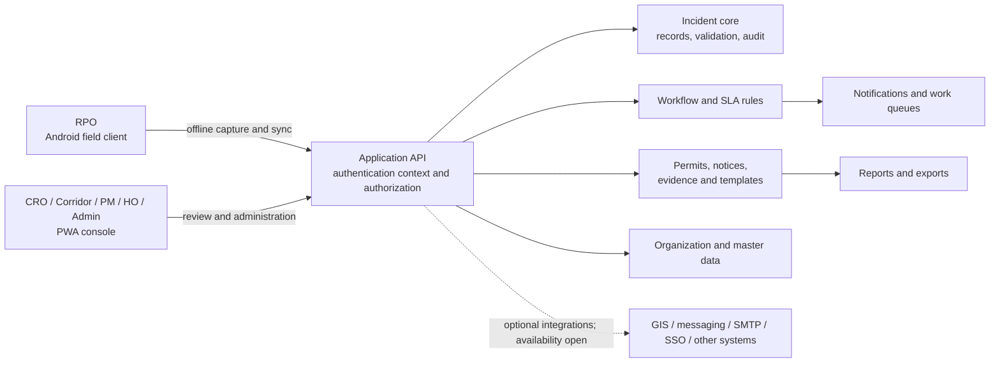
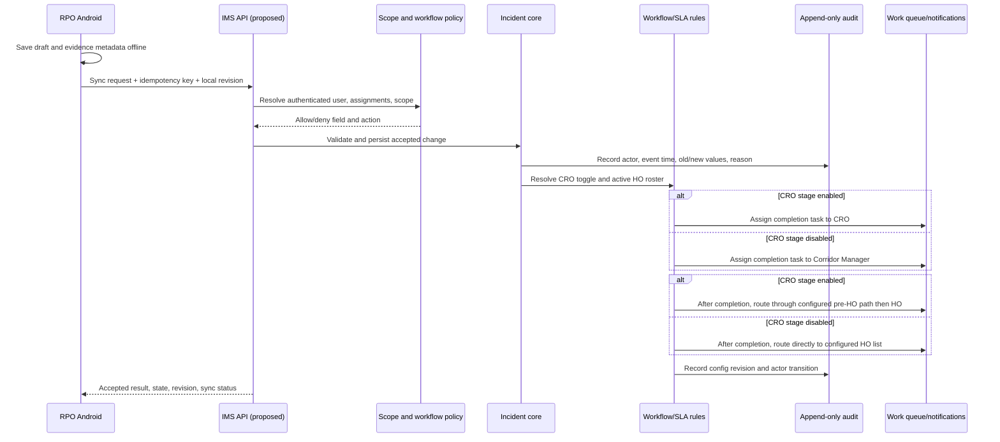

# Proposed logical architecture

**Status:** Conceptual proposal. The repository currently contains planning/source material, not application code. No cloud provider, framework, database, API gateway, identity provider, or authentication protocol is selected here.

## Constraints from the source scope

The following are stated in [IMS Scope Document v1.5](../IMS-Scope-Document.md); the document itself remains a draft:

- An Android-native, offline-first field app is for Route Patrolling Officers (RPOs). It is the only role assigned a handset in the stated baseline.
- Office workflows use a Progressive Web App (PWA) for CRO, Corridor, Project Manager, Maintenance Manager, Safety Officer, HO, and Admin.
- The design is one incident core with module configuration, a shared API/design system, and one multi-corridor deployment hosted in India.
- Corridor, project, and stretch access is enforced server-side. The RPO loses record-view access after submission; audit history is append-only.
- Field evidence is camera-captured, watermarked with time/location, and queued for offline upload. Offline forms must survive app restarts and synchronize without data loss.
- Report exports must preserve supplied NHAI/NHIT workbook formatting; the PDF is generated from the same populated workbook.

These constraints do not choose a product or implementation technology.

## Proposed component boundaries

This is a way to organize responsibilities, not a commitment to separate deployables or services.

1. **Field client** - RPO draft capture, validation, GPS and camera metadata, encrypted local draft storage, retryable synchronization, and a visible sync state.
2. **Office client** - role- and scope-aware queues, CRO completion (or Corridor Manager fallback when the toggle is off), configured pre-HO reviews, work-permit checks, notice logging, dashboards, and report requests.
3. **Application/API boundary** - validates requests, derives the acting user's effective assignments, enforces server-side permissions and scope, and records state-changing actions.
4. **Incident core** - shared identity, location, evidence references, lifecycle, audit, notifications, and common descriptive fields. Module-specific fields and rules are configuration/data, not permission bypasses.
5. **Workflow and SLA capability** - evaluates module/state transitions, deadlines, escalation, returns, reopen, and scheduled auto-close; reads the CRO-stage toggle and routes every workflow to the configured HO final-approver list.
6. **Supporting capabilities** - master data; permit-to-work and SWI; encroachment milestones; evidence/document handling; report template registry and exports; integrations.
7. **External systems/parties** - GIS, messaging, SMTP, SSO, FIR reference, VMS/ATMS, CCTV, weather, or ERP integrations are prioritized in the source but remain subject to availability and go-live decisions. PIU, PD, and SP have no IMS user access in the source model; their notices are recorded by the Corridor.

## Conceptual data boundaries

The following nouns are design aids only. Names, storage shape, and identifiers are not approved.

- **User**: a person who may authenticate; organization membership and status are separate from role definitions.
- **Role template / permission**: reusable capability set; a user's effective access comes from active assignments and scope (see [Users, roles, and access](roles-and-access.md)).
- **Incident**: common identity, family/subtype, location, chronology, evidence references, current workflow state, and version.
- **Module details**: accident report, violence/unrest details, or temporary/permanent encroachment-specific data.
- **Workflow action**: actor, action, previous/next state, timestamp, reason, and applicable SLA.
- **Evidence/document**: metadata, capture provenance, and storage reference; binary storage technology is undecided.
- **Permit / safety check / SWI**: work authorization, verifications, linked work-zone incidents, suspension, and close-out.
- **Notice milestone**: offline-issued document reference, printed issue date, allowed period, recorded date, evidence, and ageing status.
- **Report template/export**: template version/effective date, mapping, generated workbook, corresponding PDF, and provenance.
- **Audit event**: append-only field/action history with actor, time, old/new values, and reason.

## Conceptual request and data flow

1. An assigned RPO creates a local draft; the client validates fields and captures GPS/time/evidence metadata.
2. On synchronization, the API resolves the user's current assignment and scope, rejects unauthorized or malformed changes, and safely accepts retries.
3. Submission locks the RPO's edit/view permissions as specified; the CRO toggle assigns the completion-stage task to CRO or Corridor Manager.
4. With CRO enabled, the completion stage follows the configured pre-HO route; that route remains open. With CRO disabled, Corridor Manager completion routes directly to the configured HO list without a separate Corridor review step.
5. Every workflow reaches an eligible HO final approver. Workflow settings, task assignment, transition, decision, and configuration revision are audited; a Corridor Manager's completion does not imply review or approval authority. Whether the same identity can also appear on the HO list is open.
6. Workflow rules update queues, deadlines, escalation, and (for accidents) scheduled auto-close. A closed incident can only be reopened by HO/Admin under the source rule; reconcile the source auto-close trigger with the new HO gate.
7. Reporting reads authorized incident data and writes into the active prescribed template version; template version and export history remain traceable.

## Required qualities and open design work

The source specifies offline-first behavior, encrypted local storage, retry/resume, server-side scope checks, immutable audit, 8+ year retention for accident/encroachment records, India hosting, and performance targets. Detailed threat model, key management, backup/restore, retention exceptions, observability, disaster recovery, and deployment topology still need design.

Do not implement the proposal until the source's open questions and the user/role model are reviewed. In particular, work-zone Project Manager authority conflicts with the baseline accident observer rule; see [Scope and traceability](scope-and-traceability.md).

## System context

The diagram distinguishes source requirements from a proposed internal boundary. The boxes are logical capabilities; they do not imply a microservice deployment.

## Component responsibilities and interfaces

| Logical component | Owns | Must not own |
|---|---|---|
| Android field client | Local RPO draft, field validation feedback, device-capture metadata, queued evidence, sync status | Authoritative approval state, role grants, or server scope decisions |
| PWA office client | Work queues, permitted review/edit forms, permit checks, notice entry, report requests, administrative screens | Authorization decisions based only on hidden/disabled UI controls |
| API / policy boundary | Validates identity context, active assignment, scope, field/action permission, request shape, and concurrency | User-selected state changes that bypass workflow policy |
| Incident core | Shared identity, module, location, lifecycle reference, source data, and links to workflow/evidence/audit | Module-specific legal/operational decisions that have not been approved |
| Workflow/SLA capability | Allowed transitions, CRO toggle, task ownership, deadlines, escalation, configured HO final-approver roster, reopen rules, and scheduled accident auto-close | Human severity, causal analysis, notice service, or external legal decisions |
| Evidence/document capability | Evidence metadata, provenance, references, upload status, and retention policy hooks | A claim that client-supplied timestamps alone are trusted evidence |
| Permit and encroachment capabilities | Permit/check/SWI links and dated encroachment milestones | Direct access for PIU, PD, or SP, which is excluded by the source |
| Reporting capability | Report selection, template version, field mapping, generated workbook/PDF, export audit | Recreating/restyling the prescribed workbook in place of its template |
| Master/organization capability | Corridor/project/stretch hierarchy and editable lookup data | Unscoped access or hard-coded user assignments |

## Data flow and trust boundaries

The authenticated principal comes from a future, approved identity integration; clients must not assert their own role, user identity, or organizational scope. A device's capture time is retained as provenance but is distinct from server receipt time. The server validates current authorization on synchronization because assignments can change while a device is offline.

## Data ownership and lifecycle

- **Authoritative record:** server-side incident, master data, workflow state, permissions, and audit history. The device holds a temporary encrypted working copy for offline capture.
- **Draft:** editable according to assignment and field ownership. A queued create has a client-generated retry identity so replay does not intentionally create a second incident.
- **Submitted incident:** server assigns the workflow state and removes RPO view access. A later correction must use an allowed return/amendment path and create an audit event; the source's 15-minute grace edit is only a risk mitigation proposal.
- **Evidence:** capture metadata and server receipt metadata remain distinguishable; binaries follow an undecided storage/retention design. Enforce the approved live-camera, watermark, size, and count rules at the service boundary.
- **Notice:** retain both the printed issue date and the later entry/receipt date; calculate the notice clock from the printed date and flag late recording.
- **Export:** record the source data cutoff, report type, template version/effective date, requester, and output references so an historical report can be explained or regenerated.

## Runtime and operational boundaries

The source specifies one multi-corridor instance hosted in India, organization-scoped data, 8+ year retention for accident and encroachment records, and performance targets (cold start <=3 s, lists <=2 s, API p95 <=500 ms, monthly report pack <=30 s). The source does not define availability targets, RPO/RTO, key custody, encryption algorithms, network topology, backup frequency, or monitoring products; these require architecture decisions before production.

Keep the deployment design capable of isolating corridor/project data server-side. Do not equate "single instance" with a particular hosting model or database. Integration priorities in source Section 12 are high (GIS, SMS/WhatsApp, SMTP, SSO), medium (FIR reference, VMS/ATMS), and low (CCTV, weather, ERP); priority does not mean an integration is confirmed available.

## Design review checklist

- Confirm source scope and the open A2 Project Manager permission before finalizing transitions.
- Define dynamic user and role assignment governance; do not hard-code the seed roles as the only possible roles.
- Decide offline conflict handling for anything other than masters and drafts; the source states server-wins for masters and client-wins for drafts only.
- Confirm how camera/GPS metadata, local encryption, key loss, device replacement, and upload retries are handled.
- Obtain blank NHAI workbooks at P0 and resolve the 17-versus-16 report discrepancy before finalizing the report service.
- Approve retention, backup/recovery, audit access, legal holds, and operational service targets.
