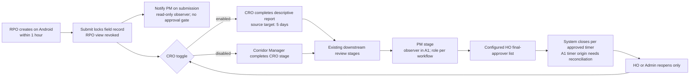

# End-to-end workflows

**Status:** Derived from [IMS Scope Document v1.5](../IMS-Scope-Document.md) and extended by later user-directed CRO-toggle and HO-final-approver requirements. The source remains a draft; unresolved decisions are called out below.

## User-directed routing rules

These later user decisions extend the unchanged v1.5 source:

- The **CRO availability toggle** controls only who completes the CRO stage: CRO when enabled; Corridor Manager when disabled. It does not change any downstream review or approval stage.
- **Every in-scope workflow ends at the configured HO final-approver list.** Preserve each workflow's existing stages and order, including PM before HO where specified. A1's PM remains a read-only observer, not an approver. Roster selection semantics (one listed approver, all, quorum, or sequence) remain open.
- Whether a Corridor Manager who completed the CRO stage may also perform a later Corridor review or be selected as the HO approver is unresolved segregation-of-duties policy. Do not infer either permission or prohibition.

## Road-user accident (A1)

1. RPO creates a basic incident on the Android app, own project only; GPS, device time, and camera evidence are captured. Submit validates and locks the record and revokes RPO view access.
2. The toggle routes the CRO completion work (department inputs, vehicle/casualty details, response, damage, and cause analysis) to CRO or Corridor Manager. The source's 5-day target belongs to this completion stage; confirm whether its start/stop semantics change when the fallback actor is used.
3. After either actor completes the stage, retain the existing downstream route. For A1, this includes Corridor review within 48 hours and a read-only PM observer before the newly required HO final stage. Do not turn the PM observer into an approver.
4. Route the workflow to an eligible member of the configured HO final-approver list. The roster's one/all/quorum/sequence rule is not yet defined.
5. The source says A1 auto-closes three days after Corridor approval. Reconcile this timer's trigger with the new mandatory HO final gate before configuration. HO/Admin alone may reopen under the source rule; restart behavior remains subject to the workflow policy.

Confirm calendar versus working-day meaning before configuring SLAs (Q6). The new HO gate supersedes the source's statement that A1 has no HO approval stage; do not edit the source document to hide this change.

## Work-zone accident (A2) and permit

The source requires a linked active permit, work-zone checks, and Safety involvement. A permit proceeds from initiation and Corridor endorsement through Maintenance Manager physical verification, Safety Officer verification/SIMOPS, Project Manager authorization, controlled execution, and close-out. Maintenance and Safety enter checks in the PWA after site visits; actual inspection time must be distinct from entry time.

An incident linked to a permit suspends it, raises a Stop Work Instruction (SWI), and blocks permit close-out until the incident is closed. An incident without an active permit is recorded as non-permitted activity with a reason and routed to Safety.

**Open conflict:** Section 4.2 gives the A2 Project Manager view-only access; Q2 recommends Project Manager approval for A2. Keep the transition configurable and do not encode either outcome as final until this decision is approved. R12 also flags delayed desk-based Safety Officer entry; the source recommends immediate phone notification and same-shift logging.

## Encroachment

- **Temporary:** capture location, type, shift, action, responsible team, and before/after photos; typically removed on the spot within the same shift. No statutory notice cycle.
- **Permanent:** register the case, then track offline-issued Notice 1, Notice 2, Notice 3, PD notice, SP letter/request for police assistance, removal evidence/cost, cost recovery, and closure outcome. Corridor records references, printed issue dates, allowed periods, and scanned proof. Ageing starts from the printed date; legal appeal handling and notice intervals remain open (Q4-Q5).

## Violence and Public Unrest

Both use RPO capture, a CRO completion stage (actor selected only by the CRO toggle), source-defined co-approval/review roles, and the configured HO final-approver list. Violence adds Security co-approval; Public Unrest adds Management co-approval. Preserve the existing downstream order, including PM before HO where specified; the precise order/ownership of other pre-HO stages remains open where the source is silent. Capture the module-specific people, harm, property, police, crowd, road-blockage, and operational-impact details identified in source Section 8.

## Natural Disaster and cross-flow states

The full Natural Disaster module is out of scope because its SOP is not supplied. Q1 recommends a minimal record for downtime reporting, but this remains a decision; if later approved as an in-scope workflow, it must end at the configured HO list. Other source lifecycle states include DRAFT, SUBMITTED, PENDING_CRO, PENDING_CORRIDOR, APPROVED, AUTO_CLOSED, REOPENED, PENDING_PROJECT_MANAGER, PENDING_HO, CLOSED, REWORK_REQUIRED, ESCALATED, CANCELLED, and SWI_ACTIVE (work zone only).

## Common controls

Server-side scope and role checks apply to every operation. Audit state changes and reasons; notify approvers; expose SLA ageing/escalation; validate field values and evidence; preserve the distinction between event time, capture time, server receipt time, and printed notice date. Final severity, root-cause analysis, police coordination, notice service/removal, insurance negotiation, and dispute resolution remain human decisions.

## A1 transition specification

| From | Actor / action | To | Timer and start event | Validation / side effects |
|---|---|---|---|---|
| No record | RPO saves draft | `DRAFT` | RPO must enter within 1 hour of receiving accident information | Own project; capture date/time, chainage, direction, road type, GPS, category, crash/nature/severity, counts, photos, description |
| `DRAFT` | RPO submits | `SUBMITTED` then completion-stage state (`PENDING_CRO` in source) | Stops RPO 1-hour capture clock; starts completion-stage 5-day clock from incident creation | Required fields; lock submission; revoke RPO view; notify PM as read-only observer; create task for CRO or Corridor Manager from toggle |
| Completion stage (toggle enabled) | CRO completes and submits | `PENDING_CORRIDOR` | Source target: 5 days from incident creation | Require report identity, location, vehicles, injured persons, cause analysis; reconcile Part 2 counts with Part 1; retain both values and justify severity changes. Record actual actor |
| Completion stage (toggle disabled) | Corridor Manager completes and submits in place of CRO | `PENDING_CORRIDOR`; same downstream path as enabled | Source 5-day completion target applies to the stage; confirm behavior on reopened cycles | Same required report validation; record Corridor Manager as actor, not CRO. Later Corridor review remains in the workflow |
| `PENDING_CORRIDOR` | Corridor reviews/comments/edits and approves | `PENDING_PROJECT_MANAGER` | Source target: within 48 hours after completion-stage submission; confirm fallback clock boundary | Record decision/comment and edits as audit events; same-person completion/review eligibility remains open |
| `PENDING_PROJECT_MANAGER` | PM observes the A1 record (read-only; no approval gate) | `PENDING_HO` | PM is notified on submission; no PM approval timer | Preserve view-only access; PM observation must not be treated as an approval |
| `PENDING_HO` | Eligible member of configured HO list gives final decision | `APPROVED` | No HO-stage duration is specified | Validate active roster membership and approved roster-selection rule; audit approver, decision, reason, and configuration version |
| `APPROVED` | System scheduler closes | `AUTO_CLOSED` | Source says 3 days after Corridor approval; whether the timer starts at Corridor or HO approval is open | Record system actor and close time; never skip the required HO decision |
| `AUTO_CLOSED` | HO/Admin reopens | `REOPENED`, then completion stage resumes | No fixed duration | Only HO/Admin under source rule; record reason; toggle selects completion actor; reset 5-day/48-hour clocks only per approved policy |

`SUBMITTED` may be a transient state; the source Section 4.3 lists both `SUBMITTED` and `PENDING_CRO`. Whether `PENDING_CRO` remains the state label when Corridor Manager performs that stage, and the exact pre-HO states, need detailed design. State persistence and clock boundary semantics are open.

```mermaid
stateDiagram-v2
  [*] --> DRAFT
  DRAFT --> SUBMITTED: RPO submits
  SUBMITTED --> PENDING_CRO: Toggle assigns CRO or Corridor Manager
  PENDING_CRO --> PENDING_CORRIDOR: CRO enabled; CRO submits
  PENDING_CRO --> PENDING_CORRIDOR: CRO disabled; Corridor Manager substitutes for CRO
  PENDING_CORRIDOR --> PENDING_PROJECT_MANAGER: Corridor review
  PENDING_PROJECT_MANAGER --> PENDING_HO: PM observes; no approval gate
  PENDING_HO --> APPROVED: HO roster final decision
  APPROVED --> AUTO_CLOSED: Scheduler; timer origin open
  AUTO_CLOSED --> REOPENED: HO or Admin reopens
  REOPENED --> PENDING_CRO: Toggle assigns completion actor
```

The source lists `PENDING_PROJECT_MANAGER`; on A1 it represents a read-only observation stage, not approval. The diagram omits `REWORK_REQUIRED`, return targets, and `ESCALATED`/`CANCELLED` transitions because the source names those states but does not define every transition or clock effect. The new HO gate is user-directed and follows the unchanged A1 stages.

### A1 capture validation

Source Section 5.2 provides these controls for the RPO form:

- Occurrence date/time cannot be in the future; an entry older than 48 hours requires CRO approval.
- Chainage must be within the project's configured start/end; capture GPS accuracy should be 50 m or better. More than 1 km from chainage warns and asks for a reason.
- Crash type drives valid nature-of-accident options and vehicle-count checks. Casualty totals cannot exceed total persons; uninjured is calculated and cannot be negative. Severity must agree with casualty counts and is recomputed/confirmed by CRO.
- Accident photos: minimum 2, maximum 10; safety-arrangement photos: minimum 1, maximum 10. Scope says live camera, watermark of time/location/chainage, 2 MB maximum, offline queue.
- Text description is 20-1000 characters; draft may be incomplete, submission may not.
- The source calls the RPO form 21 fields and separately recommends an SPV/Vendor Member Involved field 22 (Q3). Do not present field 22 as approved.

### A1 exceptions and audit

The source lifecycle includes `REWORK_REQUIRED`, `ESCALATED`, and `CANCELLED`. It does not fully specify who can return at every stage, cancellation permissions/reasons, or whether the clock pauses during rework. Capture actor, action, previous/resulting state, timestamp, reason, field old/new values, and attachments. A suspected duplicate or invalid record may be cancelled; a late SLA becomes visible/escalated rather than silently extending its deadline. Risk R4 suggests a 15-minute grace edit, but this is not a confirmed exception to RPO access revocation.

## A2 permit and work-zone specification

### Permit path

The source specifies this sequence but not permit-state codes. Labels below are conceptual aliases for discussion, not approved enum values.

| Transition (conceptual) | Actor / action | Validation and gate | Timer / exception | Minimum audit evidence |
|---|---|---|---|---|
| No permit -> `DRAFT` | Site Engineer / Supervisor initiates before work | Work, method, location, hazards, planned validity, and applicable checklist | No initiation SLA specified; work cannot begin before authorization | Initiator, creation time, submitted values, permit scope |
| `DRAFT` -> `CORRIDOR_REVIEW` -> `CORRIDOR_ENDORSED` | Corridor endorses plan and work-zone extent | Verify work plan and extent; return/rework rules are not specified | No approval duration specified | Reviewer, decision, comments, plan/extent changes |
| `CORRIDOR_ENDORSED` -> `MAINTENANCE_VERIFIED` | Maintenance Manager conducts physical verification and enters checks in PWA | Checklist result and actual site-inspection time; failed-item behavior is not fully defined | Entry may occur after the visit; preserve actual inspection and entry timestamps | Inspector, actual inspection time, entry time, answers, failed items, evidence |
| `MAINTENANCE_VERIFIED` -> `SAFETY_VERIFIED` or `SWI_ACTIVE` | Safety Officer verifies safety/SOP/SIMOPS and records disposition | Failed safety control leads to SWI; do not authorize work while stop-work controls remain open | No check SLA specified | Safety actor, inspection/instruction time, answers, reasons, corrective evidence |
| `SAFETY_VERIFIED` -> `ACTIVE` | Project Manager authorizes work | Authorization is distinct from approval of an A2 incident | No authorization SLA specified | Authorizer, decision time, conditions, validity window |
| `ACTIVE` -> `SUSPENDED` + `SWI_ACTIVE` | System/workflow on a linked incident; Safety Officer records stop-work | Incident link, failed checks, and SWI reason; permit close-out is blocked while incident is open | Trigger is incident occurrence; response time is not specified | Triggering incident, previous permit state, SWI actor/time, reason, notification |
| `SUSPENDED` -> `ACTIVE` | Safety Officer re-verifies after corrective action; authorized resumption required | Correction evidence and cleared stop-work condition; exact resumption authority is not specified | No correction/resumption SLA specified | Corrective action, re-check, decision, actor, timestamps |
| `ACTIVE` -> `CLOSE_OUT_PENDING` | Initiator surrenders; Safety Officer verifies close-out | Clear area, head count, outstanding checks; block while linked incident remains open | Validity expiry/extension behavior needs detailed design | Surrender time, close-out checks, area/head-count result, actor, time |
| `CLOSE_OUT_PENDING` -> configured HO final-approver list -> `CLOSED` | Route the permit workflow to an eligible HO approver | No HO approval deadline specified | This final gate is user-directed; its relationship to the PM's pre-work authorization and exact route is open | HO actor/decision/reason, permit revision, closure time |

Weather or method changes require change control; the source does not define the exact transition or approver. A failed checklist, missing evidence, expired permit, or overdue action must not silently become an authorized state; the operational exception and escalation policy need approval.

### Work-zone accident path

An A2 record is an OHS case by default, must reference an active permit when permitted work is involved, and routes through the additional Maintenance/Safety checks. Crash type plus SPV/Vendor Member Involved should determine the A1/A2 route; Q3 field 22 is recommended but open. If no active permit exists, capture it as a non-permitted activity, require a reason, and route to Safety. If an incident occurs against a permit, set it to suspended, create an SWI, retain failed checklist items in the incident dossier, and block permit close-out until incident closure.

**Unresolved transition:** Section 4.2 says PM is view-only on A2; Q2 recommends PM approval for A2. The route and actors before the now-required HO final approval remain open. The API/workflow must not emit a PM approval task for A2 until approved. Section 6 separately says PM authorizes the permit itself.

| Transition (conceptual) | Actor / action | Timer | Validation / exception | Audit evidence |
|---|---|---|---|---|
| No record -> `DRAFT` | RPO captures work-zone occurrence | A2-specific capture deadline not stated; do not assume A1's 1-hour limit | Capture source-required incident data and link permit when applicable | RPO, capture/device time, location, evidence, local request ID |
| `DRAFT` -> completion stage | RPO submits; CRO toggle selects CRO or Corridor Manager as completion actor | A2-specific completion deadline not stated; confirm whether A1's 5-day target applies | Require active permit reference for permitted work; if no active permit, require non-permitted-activity reason and route to Safety | Submission, toggle/config version, actual actor, permit reference/reason, validation result, queue creation |
| Completion stage -> existing downstream path | CRO or (toggle off) Corridor Manager completes descriptive record | Timer follows approved workflow configuration | Toggle changes only the completion actor; preserve Corridor review, Maintenance/Safety checks, and PM stage in source order. A2 PM view-only vs Q2 approval conflict remains open | Completion actor, values changed, reason, attachments, base revision, toggle version |
| Existing downstream path -> configured HO list | Corridor, Maintenance Manager, Safety Officer, then PM stage as specified by source; HO is final | No A2-specific timers stated | Preserve failed checklist items; linked incident suspends permit and raises SWI. Whether PM is observer or approver remains Q2/open; do not skip PM before HO | Each review/check decision, inspection versus entry times, failed checks, SWI, PM event, final HO queue assignment |
| HO final decision -> close / reopen | Configured HO approver decides; system closes under the approved policy | Whether A1's 3-day auto-close applies to A2 is not explicit | Do not close linked permit while incident remains open; reopening restart rules need confirmation | HO actor/decision/reason, system close event, linked permit status, reopening actor/reason |

## Encroachment transition specification

### Temporary case

State labels below are proposed because the source defines an operational flow, not a state enum.

| Transition (conceptual) | Actor / action | Timer | Validation / exceptional path | Audit evidence |
|---|---|---|---|---|
| No record -> `RECORDED` | RPO records temporary encroachment | Capture time/shift; no entry SLA specified | Chainage/side, type/nature, action, responsible actor/team, before photo | RPO, event/capture/receipt times, location, category, before image |
| `RECORDED` -> `REMOVED` -> HO final approval -> `CLOSED` | Field team removes; RPO records outcome; configured HO approver makes final decision | Typically same shift for removal; no HO approval deadline specified | After photo and removal action; if not removed same shift, retain open and flag for operational follow-up (exact owner/policy open) | Removal time, team, action, before/after evidence, HO actor/decision/reason, closure time |

### Permanent case and notice clocks

The milestone progression and state labels below are conceptual; statutory notice periods are not supplied here. The notices/letters are issued outside IMS, and PIU, PD, and SP do not log in.

Source V-B specifies the approval order CRO -> Corridor -> Project Manager -> HO. The toggle changes only who performs the CRO stage: when disabled, Corridor Manager substitutes for CRO, then Corridor review and the PM-before-HO approvals remain in that order. The permanent-case notice, removal, and cost-recovery milestones remain in their source order and are recorded by Corridor; how the approval chain joins those milestones is not explicitly mapped and must not be used to reorder either path. The temporary flow has no separately specified CRO stage, so the toggle applies only if one is approved for it.

| Transition (conceptual) | Issuer / IMS recorder | Required evidence / validation | Timer / exception | Audit evidence |
|---|---|---|---|---|
| No record -> `REGISTERED` | RPO / RPO | Chainage, side, locality, category, establishment date, distance from road edge, encroacher, initial photo | Age from detection; late entry must be visible | Discoverer, event/capture/entry times, location, category, evidence |
| `REGISTERED` -> `NOTICE_1_RECORDED` -> `NOTICE_2_RECORDED` -> `NOTICE_3_RECORDED` | PIU issues offline / Corridor records | Notice number, printed issue date, allowed period, scanned proof, service/acknowledgement | Age each stage from printed issue date; intervals are Q4/open and must not be invented | Issuer, recorder, reference, printed date, recorded time, allowed period, document, late-entry indicator |
| `NOTICE_3_RECORDED` -> `PD_NOTICE_RECORDED` | PD / Corridor | Reference, printed date, allowed period, copy | Period is open (Q4); keep the case overdue/visible rather than substituting an assumed duration | Same notice metadata plus escalation/exception reason |
| `PD_NOTICE_RECORDED` -> `SP_ASSISTANCE_RECORDED` | PD to SP / Corridor | Section 37 assistance request, reference/date/copy | Timing and status while awaiting response are open | Sender/recipient, reference, printed date, recorded time, proof |
| `SP_ASSISTANCE_RECORDED` -> `REMOVAL_RECORDED` | Field team with police assistance / Corridor | Equipment/manpower, date/cost, before/after photos, panchnama | Record actual completion date; no duration specified | Participants, event time, cost, action, evidence |
| `REMOVAL_RECORDED` -> `COST_RECOVERY_RECORDED` | Finance / PD / Corridor | Bill under Section 25, amount, recovery status | IMS tracks status; accounting execution is outside scope | Reference, amount, status, actor, dates |
| CRO stage -> Corridor review -> PM approval -> HO final | CRO or toggle-off Corridor Manager completes; Corridor and PM perform the unchanged source stages; configured HO list gives final approval | No HO approval deadline specified | The toggle changes only the completion actor. Preserve the notice, removal, and cost-recovery milestones in their source order; the join point between this approval chain and the statutory milestones, appeal pause/clock behavior, and terminal-state rules are open | Completion actor/toggle version, Corridor and PM decisions, HO actor/decision/reason, source documents, outcome/time |

Each milestone is append-only evidence. Preserve `printedIssueDate`, `recordedAt`, `allowedPeriod`, and `documentReference` separately. Alert when a stage is overdue using an approved period; do not invent notice durations. Late entry must not reset the clock.

## Violence, Public Unrest, and Natural Disaster

The source identifies the non-accident approval chain but does not define these modules' complete state enums, field-level gates, or SLAs. Use the transition names below as stage descriptions, not state-code commitments.

| Family / transition | Actor / action | Timer | Validation / exceptional path | Audit evidence |
|---|---|---|---|---|
| Violence: RPO -> completion stage | RPO captures; CRO toggle selects CRO or Corridor Manager | No module-specific duration stated | Record people, weapon, injuries, property, CCTV, police/FIR, security deployment, and tolling impact; exact return/cancel rules open | Actor, toggle version, state/stage change, values, evidence, reason |
| Violence: completion -> Corridor -> PM -> HO | CRO or toggle-off Corridor Manager completes the stage; Corridor reviews, PM approves, and the configured HO list is final; retain Security co-approval | No duration stated | Toggle does not alter the route; exact position of Security co-approval relative to the source chain remains open | Completion actor/toggle version; Corridor, PM, and Security decisions; final HO actor/time/decision/reason |
| Public Unrest: RPO -> completion stage | RPO captures; CRO toggle selects CRO or Corridor Manager | No module-specific duration stated | Record crowd, blockade, direction/duration, cause/organizer, police, alternate route, toll impact; exact return/cancel rules open | Actor, toggle version, state/stage change, values, evidence, reason |
| Public Unrest: completion -> Corridor -> PM -> HO | CRO or toggle-off Corridor Manager completes the stage; Corridor reviews, PM approves, and the configured HO list is final; retain Management co-approval | No duration stated | Toggle does not alter the route; exact position of Management co-approval relative to the source chain remains open | Completion actor/toggle version; Corridor, PM, and Management decisions; final HO actor/time/decision/reason |
| Natural Disaster | No approved in-scope workflow | Not applicable | Full module excluded until SOP is supplied; Q1's minimal downtime record is only a recommendation. If a workflow is approved, it must end at the configured HO list | Define audit requirements before implementation |

## Queue, notification, and audit behavior

Proposed implementation interpretation, subject to approval:

- On each accepted transition, create the next actor's queue item and notify that actor; project PM is notified of accident submissions as an observer.
- The final approval task resolves against the configured HO roster. If no eligible approver can be resolved, keep the record pending and report a configuration error; do not silently skip the final gate.
- Track the stage-entry time, due time, completion time, actor, and reason. A scheduler marks overdue items `ESCALATED` according to configured escalation policy; the source does not specify every recipient or interval.
- Preserve a chronological audit event for create, edit, submit, approve, return, reopen, cancel, evidence upload, permit check, notice milestone, auto-close, and export.
- Keep server receipt and device/event time distinct. Backdated data must be visible; detailed back-dating rules are open.
- Fail closed when the caller's assignment, scope, or workflow authorization is absent or ambiguous.
