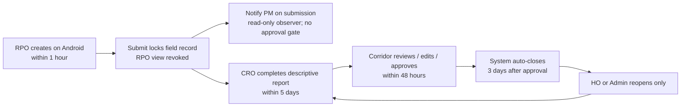
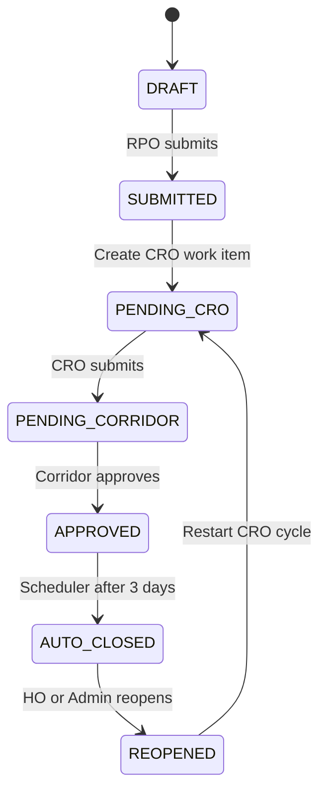

# End-to-end workflows

**Status:** Source-derived from [IMS Scope Document v1.5](../IMS-Scope-Document.md). The source is a draft; unresolved decisions are called out below.

## Road-user accident (A1)

1. RPO creates a basic incident on the Android app, own project only; GPS, device time, and camera evidence are captured. Submit validates and locks the record and revokes RPO view access.
2. CRO completes the descriptive accident report using department inputs, vehicle/casualty details, emergency response, damage, and cause analysis. The source sets a 5-day limit.
3. Corridor Incharge reviews, comments/edits, and makes the accountable accident approval within 48 hours of CRO submission.
4. Project Manager is notified and may view accident records/evidence but cannot approve, edit, or return them under the A1 baseline.
5. System auto-closes three days after approval. HO/Admin alone may reopen; the record returns to CRO, and the 5-day/48-hour cycle repeats after reopening.

No Project Manager or HO approval gate is in this A1 flow. Confirm calendar versus working-day meaning before configuring SLAs (Q6).

## Work-zone accident (A2) and permit

The source requires a linked active permit, work-zone checks, and Safety involvement. A permit proceeds from initiation and Corridor endorsement through Maintenance Manager physical verification, Safety Officer verification/SIMOPS, Project Manager authorization, controlled execution, and close-out. Maintenance and Safety enter checks in the PWA after site visits; actual inspection time must be distinct from entry time.

An incident linked to a permit suspends it, raises a Stop Work Instruction (SWI), and blocks permit close-out until the incident is closed. An incident without an active permit is recorded as non-permitted activity with a reason and routed to Safety.

**Open conflict:** Section 4.2 gives the A2 Project Manager view-only access; Q2 recommends Project Manager approval for A2. Keep the transition configurable and do not encode either outcome as final until this decision is approved. R12 also flags delayed desk-based Safety Officer entry; the source recommends immediate phone notification and same-shift logging.

## Encroachment

- **Temporary:** capture location, type, shift, action, responsible team, and before/after photos; typically removed on the spot within the same shift. No statutory notice cycle.
- **Permanent:** register the case, then track offline-issued Notice 1, Notice 2, Notice 3, PD notice, SP letter/request for police assistance, removal evidence/cost, cost recovery, and closure outcome. Corridor records references, printed issue dates, allowed periods, and scanned proof. Ageing starts from the printed date; legal appeal handling and notice intervals remain open (Q4-Q5).

## Violence and Public Unrest

Both use RPO capture, CRO completion, Corridor review, Project Manager approval, and HO approval. Violence adds Security co-approval; Public Unrest adds Management co-approval. Capture the module-specific people, harm, property, police, crowd, road-blockage, and operational-impact details identified in source Section 8.

## Natural Disaster and cross-flow states

The full Natural Disaster module is out of scope because its SOP is not supplied. Q1 recommends a minimal record for downtime reporting, but this remains a decision. Other source lifecycle states include DRAFT, SUBMITTED, PENDING_CRO, PENDING_CORRIDOR, APPROVED, AUTO_CLOSED, REOPENED, PENDING_PROJECT_MANAGER, PENDING_HO, CLOSED, REWORK_REQUIRED, ESCALATED, CANCELLED, and SWI_ACTIVE (work zone only).

## Common controls

Server-side scope and role checks apply to every operation. Audit state changes and reasons; notify approvers; expose SLA ageing/escalation; validate field values and evidence; preserve the distinction between event time, capture time, server receipt time, and printed notice date. Final severity, root-cause analysis, police coordination, notice service/removal, insurance negotiation, and dispute resolution remain human decisions.

## A1 transition specification

| From | Actor / action | To | Timer and start event | Validation / side effects |
|---|---|---|---|---|
| No record | RPO saves draft | `DRAFT` | RPO must enter within 1 hour of receiving accident information | Own project; capture date/time, chainage, direction, road type, GPS, category, crash/nature/severity, counts, photos, description |
| `DRAFT` | RPO submits | `SUBMITTED` then `PENDING_CRO` | Stops RPO 1-hour capture clock; starts CRO 5-day clock from incident creation | Required fields; lock submission; revoke RPO view; notify PM as read-only observer; create audit and CRO queue item |
| `PENDING_CRO` | CRO completes and submits | `PENDING_CORRIDOR` | 5 days from incident creation; next 48-hour clock starts on CRO submission | Require report identity, location, vehicles, injured persons, cause analysis; reconcile Part 2 counts with Part 1; retain both values and justify severity changes |
| `PENDING_CORRIDOR` | Corridor approves | `APPROVED` | Review within 48 hours after CRO submission | Record decision/comment and edits as audit events; no PM approval gate |
| `APPROVED` | System scheduler closes | `AUTO_CLOSED` | Exactly 3 days after approval in the source; calendar/business semantics open | Record system actor and close time; no manual approval gate |
| `AUTO_CLOSED` | HO/Admin reopens | `REOPENED`, then CRO work resumes | No fixed duration | Only HO/Admin; record reason; restart CRO 5-day and Corridor 48-hour clocks on the reopened cycle; new approval starts fresh auto-close clock |

`SUBMITTED` may be a transient state; the source Section 4.3 lists both `SUBMITTED` and `PENDING_CRO`. State persistence and clock boundary semantics should be decided during detailed design.

The diagram omits `REWORK_REQUIRED`, return targets, and `ESCALATED`/`CANCELLED` transitions because the source names those states but does not define every transition or clock effect.

### A1 capture validation

Source Section 5.2 provides these controls for the RPO form:

- Occurrence date/time cannot be in the future; an entry older than 48 hours requires CRO approval.
- Chainage must be within the project's configured start/end; capture GPS accuracy should be 50 m or better. More than 1 km from chainage warns and asks for a reason.
- Crash type drives valid nature-of-accident options and vehicle-count checks. Casualty totals cannot exceed total persons; uninjured is calculated and cannot be negative. Severity must agree with casualty counts and is recomputed/confirmed by CRO.
- Accident photos: minimum 2, maximum 10; safety-arrangement photos: minimum 1, maximum 10. Scope says live camera, watermark of time/location/chainage, 2 MB maximum, offline queue.
- Text description is 20-1000 characters; draft may be incomplete, submission may not.
- The source calls the RPO form 21 fields and separately recommends an SPV/Vendor Member Involved field 22 (Q3). Do not present field 22 as approved.

### A1 exceptions and audit

The source lifecycle includes `REWORK_REQUIRED`, `ESCALATED`, and `CANCELLED`. It does not fully specify who can return at every stage, cancellation permissions/reasons, or whether the clock pauses during rework. Capture actor, action, previous/resulting state, timestamp, reason, field old/new values, and attachments. A suspected duplicate or invalid record may be cancelled; a late SLA becomes visible/escalated rather than silently extending its deadline. Risk R4 suggests a 15-minute grace edit, but this is not a confirmed exception to RPO access revocation.

## A2 permit and work-zone specification

### Permit path

The source specifies this sequence but not permit-state codes. Labels below are conceptual aliases for discussion, not approved enum values.

| Transition (conceptual) | Actor / action | Validation and gate | Timer / exception | Minimum audit evidence |
|---|---|---|---|---|
| No permit -> `DRAFT` | Site Engineer / Supervisor initiates before work | Work, method, location, hazards, planned validity, and applicable checklist | No initiation SLA specified; work cannot begin before authorization | Initiator, creation time, submitted values, permit scope |
| `DRAFT` -> `CORRIDOR_REVIEW` -> `CORRIDOR_ENDORSED` | Corridor endorses plan and work-zone extent | Verify work plan and extent; return/rework rules are not specified | No approval duration specified | Reviewer, decision, comments, plan/extent changes |
| `CORRIDOR_ENDORSED` -> `MAINTENANCE_VERIFIED` | Maintenance Manager conducts physical verification and enters checks in PWA | Checklist result and actual site-inspection time; failed-item behavior is not fully defined | Entry may occur after the visit; preserve actual inspection and entry timestamps | Inspector, actual inspection time, entry time, answers, failed items, evidence |
| `MAINTENANCE_VERIFIED` -> `SAFETY_VERIFIED` or `SWI_ACTIVE` | Safety Officer verifies safety/SOP/SIMOPS and records disposition | Failed safety control leads to SWI; do not authorize work while stop-work controls remain open | No check SLA specified | Safety actor, inspection/instruction time, answers, reasons, corrective evidence |
| `SAFETY_VERIFIED` -> `ACTIVE` | Project Manager authorizes work | Authorization is distinct from approval of an A2 incident | No authorization SLA specified | Authorizer, decision time, conditions, validity window |
| `ACTIVE` -> `SUSPENDED` + `SWI_ACTIVE` | System/workflow on a linked incident; Safety Officer records stop-work | Incident link, failed checks, and SWI reason; permit close-out is blocked while incident is open | Trigger is incident occurrence; response time is not specified | Triggering incident, previous permit state, SWI actor/time, reason, notification |
| `SUSPENDED` -> `ACTIVE` | Safety Officer re-verifies after corrective action; authorized resumption required | Correction evidence and cleared stop-work condition; exact resumption authority is not specified | No correction/resumption SLA specified | Corrective action, re-check, decision, actor, timestamps |
| `ACTIVE` -> `CLOSE_OUT_PENDING` -> `CLOSED` | Initiator surrenders; Safety Officer verifies close-out | Clear area, head count, outstanding checks; block while linked incident remains open | Validity expiry/extension behavior needs detailed design | Surrender time, close-out checks, area/head-count result, approver, closure time |

Weather or method changes require change control; the source does not define the exact transition or approver. A failed checklist, missing evidence, expired permit, or overdue action must not silently become an authorized state; the operational exception and escalation policy need approval.

### Work-zone accident path

An A2 record is an OHS case by default, must reference an active permit when permitted work is involved, and routes through the additional Maintenance/Safety checks. Crash type plus SPV/Vendor Member Involved should determine the A1/A2 route; Q3 field 22 is recommended but open. If no active permit exists, capture it as a non-permitted activity, require a reason, and route to Safety. If an incident occurs against a permit, set it to suspended, create an SWI, retain failed checklist items in the incident dossier, and block permit close-out until incident closure.

**Unresolved transition:** Section 4.2 says PM is view-only on A2; Q2 recommends PM approval for A2. The API/workflow must not emit a PM approval task for A2 until approved. Section 6 separately says PM authorizes the permit itself.

| Transition (conceptual) | Actor / action | Timer | Validation / exception | Audit evidence |
|---|---|---|---|---|
| No record -> `DRAFT` | RPO captures work-zone occurrence | A2-specific capture deadline not stated; do not assume A1's 1-hour limit | Capture source-required incident data and link permit when applicable | RPO, capture/device time, location, evidence, local request ID |
| `DRAFT` -> `PENDING_CRO` | RPO submits | A2-specific CRO deadline not stated; confirm whether A1's 5-day limit applies | Require active permit reference for permitted work; if no active permit, require non-permitted-activity reason and route to Safety | Submission, permit reference/reason, validation result, queue creation |
| `PENDING_CRO` -> `PENDING_CORRIDOR` | CRO completes and submits | A2-specific review deadlines not stated | Descriptive record and linked checklist/incident evidence; field-level completion rules need source mapping | CRO, completion time, values changed, reason, attachments |
| `PENDING_CORRIDOR` -> Maintenance/Safety checks | Corridor reviews; Maintenance Manager and Safety Officer verify work-zone facts | No A2-specific timers stated | Preserve failed checklist items; linked incident suspends permit and raises SWI | Review decisions, inspection versus entry times, failed checks, SWI |
| Checks complete -> PM observer or approval decision | Project Manager receives/view record under Section 4.2; Q2 recommends an approval gate | No timer specified | **Unresolved:** do not make PM approval a mandatory transition until Q2 is decided | Notification/read receipt if implemented; approval event only if approved |
| Approved incident -> close / reopen | System closes according to approved accident policy; HO/Admin reopen authority is stated generally | Whether A1's 3-day auto-close applies to A2 is not explicit | Do not close linked permit while incident remains open; reopen restart rules need confirmation | System close event, linked permit status, reopening actor/reason, restarted task/timers |

## Encroachment transition specification

### Temporary case

State labels below are proposed because the source defines an operational flow, not a state enum.

| Transition (conceptual) | Actor / action | Timer | Validation / exceptional path | Audit evidence |
|---|---|---|---|---|
| No record -> `RECORDED` | RPO records temporary encroachment | Capture time/shift; no entry SLA specified | Chainage/side, type/nature, action, responsible actor/team, before photo | RPO, event/capture/receipt times, location, category, before image |
| `RECORDED` -> `REMOVED` -> `CLOSED` | Field team removes; RPO records outcome | Typically same shift; no formal SLA or escalation rule specified | After photo and removal action; if not removed same shift, retain open and flag for operational follow-up (exact owner/policy open) | Removal time, team, action, before/after evidence, closure actor |

### Permanent case and notice clocks

The milestone progression and state labels below are conceptual; statutory notice periods are not supplied here. The notices/letters are issued outside IMS, and PIU, PD, and SP do not log in.

| Transition (conceptual) | Issuer / IMS recorder | Required evidence / validation | Timer / exception | Audit evidence |
|---|---|---|---|---|
| No record -> `REGISTERED` | RPO / RPO | Chainage, side, locality, category, establishment date, distance from road edge, encroacher, initial photo | Age from detection; late entry must be visible | Discoverer, event/capture/entry times, location, category, evidence |
| `REGISTERED` -> `NOTICE_1_RECORDED` -> `NOTICE_2_RECORDED` -> `NOTICE_3_RECORDED` | PIU issues offline / Corridor records | Notice number, printed issue date, allowed period, scanned proof, service/acknowledgement | Age each stage from printed issue date; intervals are Q4/open and must not be invented | Issuer, recorder, reference, printed date, recorded time, allowed period, document, late-entry indicator |
| `NOTICE_3_RECORDED` -> `PD_NOTICE_RECORDED` | PD / Corridor | Reference, printed date, allowed period, copy | Period is open (Q4); keep the case overdue/visible rather than substituting an assumed duration | Same notice metadata plus escalation/exception reason |
| `PD_NOTICE_RECORDED` -> `SP_ASSISTANCE_RECORDED` | PD to SP / Corridor | Section 37 assistance request, reference/date/copy | Timing and status while awaiting response are open | Sender/recipient, reference, printed date, recorded time, proof |
| `SP_ASSISTANCE_RECORDED` -> `REMOVAL_RECORDED` | Field team with police assistance / Corridor | Equipment/manpower, date/cost, before/after photos, panchnama | Record actual completion date; no duration specified | Participants, event time, cost, action, evidence |
| `REMOVAL_RECORDED` -> `COST_RECOVERY_RECORDED` | Finance / PD / Corridor | Bill under Section 25, amount, recovery status | IMS tracks status; accounting execution is outside scope | Reference, amount, status, actor, dates |
| Open case -> `CLOSED`, `REGULARIZED`, or `UNDER_APPEAL` | Corridor / PD (final authority unresolved) | Record outcome and supporting decision | Appeal pause/clock behavior and alternate terminal-state rules are Q5/open | Decision-maker, reason, source document, outcome/time |

Each milestone is append-only evidence. Preserve `printedIssueDate`, `recordedAt`, `allowedPeriod`, and `documentReference` separately. Alert when a stage is overdue using an approved period; do not invent notice durations. Late entry must not reset the clock.

## Violence, Public Unrest, and Natural Disaster

The source identifies the non-accident approval chain but does not define these modules' complete state enums, field-level gates, or SLAs. Use the transition names below as stage descriptions, not state-code commitments.

| Family / transition | Actor / action | Timer | Validation / exceptional path | Audit evidence |
|---|---|---|---|---|
| Violence: RPO -> CRO -> Corridor | RPO captures, CRO completes, Corridor reviews | No module-specific duration stated | Record people, weapon, injuries, property, CCTV, police/FIR, security deployment, and tolling impact; exact return/cancel rules open | Actor, state/stage change, values, evidence, review/comment, reason |
| Violence: Corridor -> Security co-approval and PM -> HO | Security co-approves; PM and HO approve in source chain | No duration stated | Whether Security acts before/with/after PM is unspecified; do not infer sequence. Final close/reopen details need confirmation | Separate co-approval and approval actors/times, decisions, reasons |
| Public Unrest: RPO -> CRO -> Corridor | RPO captures, CRO completes, Corridor reviews | No module-specific duration stated | Record crowd, blockade, direction/duration, cause/organizer, police, alternate route, toll impact; exact return/cancel rules open | Actor, state/stage change, values, evidence, review/comment, reason |
| Public Unrest: Corridor -> Management co-approval and PM -> HO | Management co-approves; PM and HO approve in source chain | No duration stated | Co-approval order is unspecified; do not infer sequence. Final close/reopen details need confirmation | Separate co-approval and approval actors/times, decisions, reasons |
| Natural Disaster | No approved in-scope workflow | Not applicable | Full module excluded until SOP is supplied; Q1's minimal downtime record is only a recommendation | If a minimal record is later approved, define audit requirements before implementation |

## Queue, notification, and audit behavior

Proposed implementation interpretation, subject to approval:

- On each accepted transition, create the next actor's queue item and notify that actor; project PM is notified of accident submissions as an observer.
- Track the stage-entry time, due time, completion time, actor, and reason. A scheduler marks overdue items `ESCALATED` according to configured escalation policy; the source does not specify every recipient or interval.
- Preserve a chronological audit event for create, edit, submit, approve, return, reopen, cancel, evidence upload, permit check, notice milestone, auto-close, and export.
- Keep server receipt and device/event time distinct. Backdated data must be visible; detailed back-dating rules are open.
- Fail closed when the caller's assignment, scope, or workflow authorization is absent or ambiguous.
