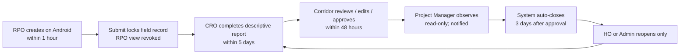

# End-to-end workflows

**Status:** Source-derived from [IMS Scope Document v1.5](../IMS-Scope-Document.md). The source is a draft; unresolved decisions are called out below.

## Road-user accident (A1)

1. RPO creates a basic incident on the Android app, own project only; GPS, device time, and camera evidence are captured. Submit validates and locks the record and revokes RPO view access.
2. CRO completes the descriptive accident report using department inputs, vehicle/casualty details, emergency response, damage, and cause analysis. The source sets a 5-day limit.
3. Corridor Incharge reviews, comments/edits, and makes the accountable accident approval within 48 hours of CRO submission.
4. Project Manager is notified and may view accident records/evidence but cannot approve, edit, or return them under the A1 baseline.
5. System auto-closes three days after approval. HO/Admin alone may reopen; the record returns to CRO, and the 5-day/48-hour cycle repeats after reopening.

No Project Manager or HO approval gate is in this A1 flow. Confirm calendar versus working-day meaning before configuring SLAs (Q6).

## Work-zone accident (A2) and permit

The source requires a linked active permit, work-zone checks, and Safety involvement. A permit proceeds from initiation and Corridor endorsement through Maintenance Manager physical verification, Safety Officer verification/SIMOPS, Project Manager authorization, controlled execution, and close-out. Maintenance and Safety enter checks in the PWA after site visits; actual inspection time must be distinct from entry time.

An incident linked to a permit suspends it, raises a Stop Work Instruction (SWI), and blocks permit close-out until the incident is closed. An incident without an active permit is recorded as non-permitted activity with a reason and routed to Safety.

**Open conflict:** Section 4.2 gives the A2 Project Manager view-only access; Q2 recommends Project Manager approval for A2. Keep the transition configurable and do not encode either outcome as final until this decision is approved. R12 also flags delayed desk-based Safety Officer entry; the source recommends immediate phone notification and same-shift logging.

## Encroachment

- **Temporary:** capture location, type, shift, action, responsible team, and before/after photos; typically removed on the spot within the same shift. No statutory notice cycle.
- **Permanent:** register the case, then track offline-issued Notice 1, Notice 2, Notice 3, PD notice, SP letter/request for police assistance, removal evidence/cost, cost recovery, and closure outcome. Corridor records references, printed issue dates, allowed periods, and scanned proof. Ageing starts from the printed date; legal appeal handling and notice intervals remain open (Q4-Q5).

## Violence and Public Unrest

Both use RPO capture, CRO completion, Corridor review, Project Manager approval, and HO approval. Violence adds Security co-approval; Public Unrest adds Management co-approval. Capture the module-specific people, harm, property, police, crowd, road-blockage, and operational-impact details identified in source Section 8.

## Natural Disaster and cross-flow states

The full Natural Disaster module is out of scope because its SOP is not supplied. Q1 recommends a minimal record for downtime reporting, but this remains a decision. Other source lifecycle states include DRAFT, SUBMITTED, PENDING_CRO, PENDING_CORRIDOR, APPROVED, AUTO_CLOSED, REOPENED, PENDING_PROJECT_MANAGER, PENDING_HO, CLOSED, REWORK_REQUIRED, ESCALATED, CANCELLED, and SWI_ACTIVE (work zone only).

## Common controls

Server-side scope and role checks apply to every operation. Audit state changes and reasons; notify approvers; expose SLA ageing/escalation; validate field values and evidence; preserve the distinction between event time, capture time, server receipt time, and printed notice date. Final severity, root-cause analysis, police coordination, notice service/removal, insurance negotiation, and dispute resolution remain human decisions.
